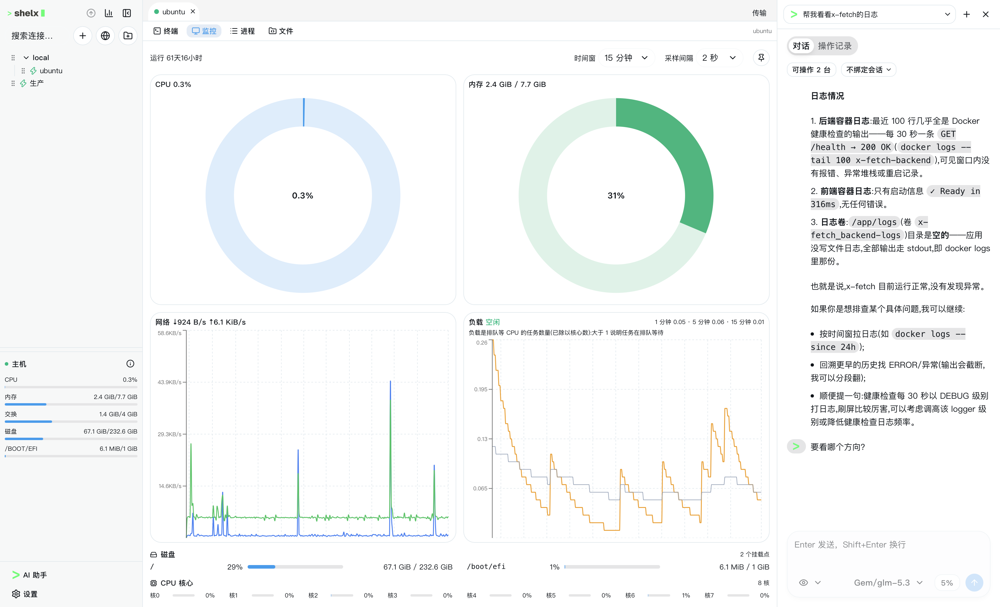
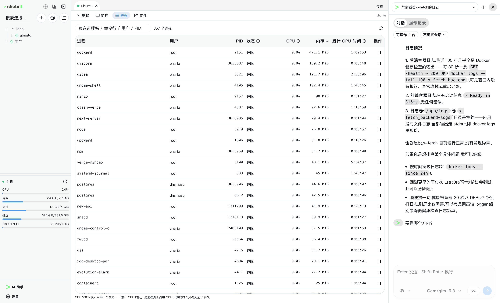
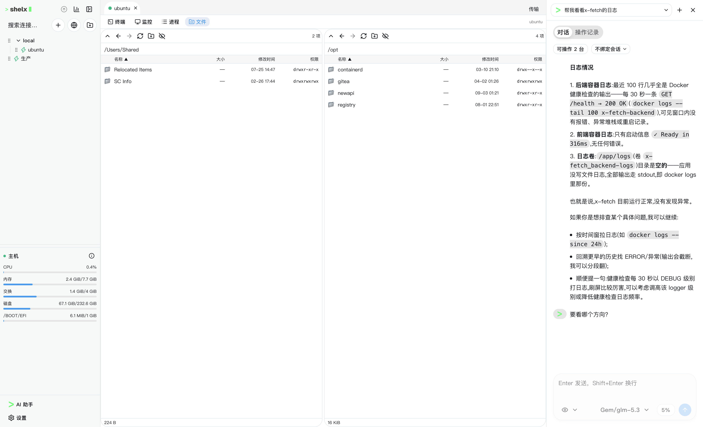
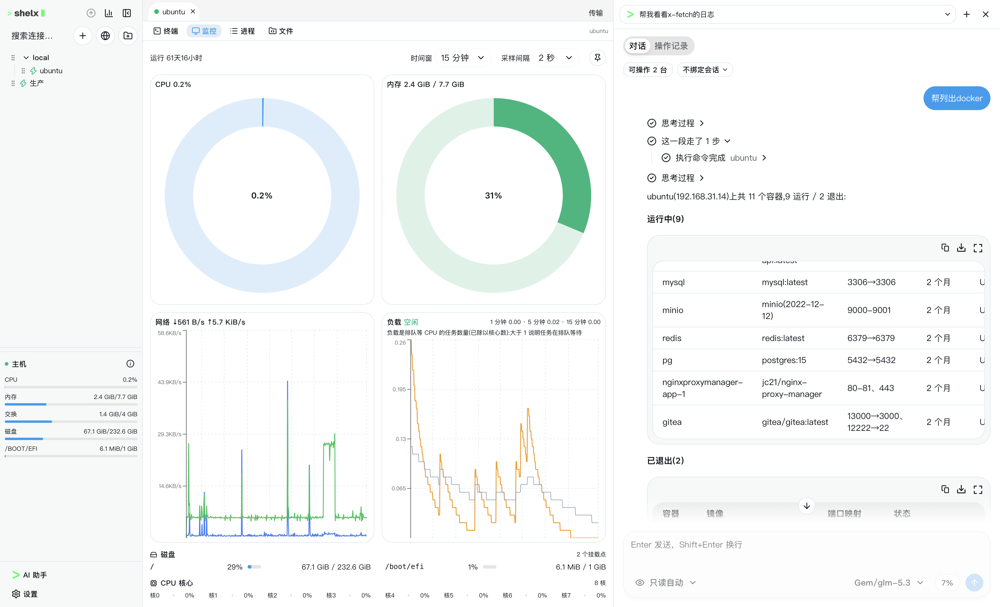

<div align="center">


# shelx

**SSH terminal · file manager · live monitoring · AI ops assistant — one lightweight desktop app**

[](LICENSE)
[](https://github.com/esyion/shelx/releases)
[](https://github.com/esyion/shelx/releases)

[English](README.md) | [简体中文](README.zh-CN.md)

</div>

---

shelx is an open-source, cross-platform server management tool. A single SSH connection carries the terminal, SFTP file management, and agentless real-time monitoring at the same time — plus a built-in AI ops assistant that can investigate and operate across your configured hosts with per-host approval.

Everything stays local: connections live in a local database, credentials go into the OS keychain, and there is no account, no cloud sync, and no telemetry.

## Screenshots

| Monitoring dashboard | Process list |
|:---:|:---:|
|  |  |

| Dual-pane file manager (SFTP) | AI assistant — operation log |
|:---:|:---:|
|  |  |

## Features

### Connection management

- Grouped connection tree with instant search, remarks, and color tags
- Password, private key (with passphrase), keyboard-interactive (OTP), and ssh-agent authentication
- Credentials stored in the OS keychain (Windows Credential Manager / macOS Keychain / Linux Secret Service); "session only" and "never save" modes available
- Host key fingerprint confirmation on first connect (TOFU); changed fingerprints block the connection with a loud warning
- Quick connect without saving anything; `ssh://` links from the browser prefill it

### SSH terminal

- Multi-tab terminals; multiple terminals (channels) per connection
- xterm.js with WebGL rendering; byte-stream end to end, switch between UTF-8 and GBK on the fly — no more mojibake on legacy Chinese servers
- Keepalive, session status dots per tab, disconnect banner with one-click reconnect that keeps the scrollback
- Themes, font size (Ctrl+scroll), copy-on-select, configurable buffer size

### Live monitoring (agentless)

- No agent or script to install — metrics are collected over SSH by parsing `/proc` with read-only commands
- CPU (total + per-core), memory & swap, network throughput, disk usage per mount point, load 1/5/15, uptime
- Adjustable sampling interval and time window; session-local history for lookback
- Pauses when the connection drops and resumes automatically on reconnect
- Process list with filtering and sorting (CPU, memory, cumulative CPU time)

### File management (SFTP)

- Dual-pane local ⇄ remote browser: sort, hidden files, breadcrumbs, direct path input
- Drag-and-drop upload/download with a background transfer queue, live progress, and cancel
- Conflict policies (overwrite / skip / keep both), recursive directory transfer
- New folder / rename / delete, visual chmod editor; virtual scrolling keeps 10,000+ entry directories smooth

### AI ops assistant

- Docked side panel — asks nothing of your workspace while it works
- Natural-language operations across all configured hosts (offline ones included; it connects on its own)
- Read-only / automatic execution modes; every write operation is held for per-host approval (once / always / reject), with the full command shown before you decide
- Streaming output with a visible chain of thought: reasoning, one timeline step per tool call, per-host progress, and a separate operation log to review everything afterwards
- Conversations persist: pinned, renamed, auto-named, reusable; an active terminal session can be bound as context, or the assistant roams freely
- Works with OpenAI (Responses API), Anthropic (Messages API), or a custom verified endpoint; long conversations compact older context automatically while token usage stays visible

## Download

Grab the latest installer from [GitHub Releases](https://github.com/esyion/shelx/releases):

- **Windows** — installer with in-place (passive) updates
- **macOS** — Apple Silicon & Intel
- **Linux** — standard Tauri packages

shelx checks for updates automatically and updates itself from GitHub Releases.

## Build from source

Prerequisites: [Rust](https://rustup.rs/) (stable) and [bun](https://bun.sh). On Linux you also need the usual Tauri dependencies (webkit2gtk, etc. — see the [Tauri prerequisites guide](https://tauri.app/start/prerequisites/)).

```bash
bun install        # install frontend dependencies
bun tauri dev      # run in dev mode with hot reload
bun tauri build    # produce installers for your platform
```

Quality gates before committing:

```bash
bun run build
bun run check:ipc
cargo fmt --manifest-path src-tauri/Cargo.toml -- --check
cargo clippy --manifest-path src-tauri/Cargo.toml --all-targets --all-features -- -D warnings
cargo test --manifest-path src-tauri/Cargo.toml
```

## Architecture

Tauri 2 desktop app with a strict split:

- **Rust core** — SSH/SFTP via [russh](https://github.com/Eugeny/russh), monitoring collection, transfer engine, and the AI agent loop ([rig](https://github.com/0xPlaygrounds/rig)); layered as commands → application → domain → infrastructure
- **Frontend** — Next.js (static export) + React 19 + TypeScript + Tailwind CSS + shadcn/ui (Base UI), xterm.js for the terminal, Recharts for monitoring, Zustand for state
- One SSH connection (one authentication) multiplexes all terminal, SFTP, and monitoring channels
- The IPC contract is defined once on the Rust side, exported as JSON Schema, and generated into TypeScript types (`bun run gen:ipc`) — the frontend never hand-writes mirror types. See [docs/IPC_CONTRACT.md](docs/IPC_CONTRACT.md)

## Security & privacy

- Credentials only ever live in the OS keychain (or encrypted fallback); never in plain files, logs, or IPC responses
- Host keys are verified with TOFU; a changed key cannot be silently accepted
- No telemetry, no cloud, no accounts, no ads
- The AI assistant runs remote commands as argv arrays against an allowlist; write operations require explicit per-host approval, and a read-only mode keeps it from touching anything

## Documentation

- [docs/PRD.md](docs/PRD.md) — product requirements
- [docs/TECHNICAL_DESIGN.md](docs/TECHNICAL_DESIGN.md) — technical design
- [docs/AGENT_DESIGN.md](docs/AGENT_DESIGN.md) — AI agent design
- [docs/IPC_CONTRACT.md](docs/IPC_CONTRACT.md) — IPC contract workflow
- [docs/UI_LAYOUT.md](docs/UI_LAYOUT.md) — UI layout conventions

## Contributing

Issues and pull requests are welcome. Please read [AGENTS.md](AGENTS.md) first — it defines the layering, security, and quality rules every change must follow.

## License

[MIT](LICENSE) © 2026 esyion
